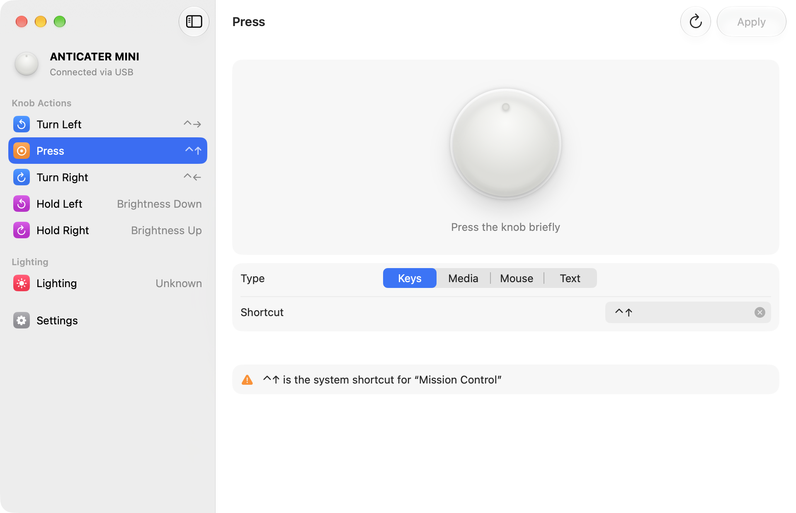

# OpenAnticater

[](https://github.com/panicilllin/OpenAnticater/actions/workflows/ci.yml)
[](LICENSE)


[简体中文](README.zh-CN.md)

An open-source, native macOS app for configuring the **ANTICATER MINI** desktop volume knob — a replacement
for the vendor's Intel-only software that runs natively on Apple Silicon.

<picture>
  <source media="(prefers-color-scheme: dark)" srcset="docs/images/app-dark.png">
  
</picture>

> **Unofficial project.** OpenAnticater is a community project and is not affiliated with, endorsed by, or
> supported by the maker of ANTICATER products. "ANTICATER" and other names are trademarks of their respective
> owners and are used here only to describe compatibility.

## Quick start

1. **Install.** Download the latest `OpenAnticater-*-arm64.dmg` from
   [Releases](https://github.com/panicilllin/OpenAnticater/releases/latest), open it and drag
   **OpenAnticater** onto **Applications**. The build is not notarized by Apple, so the first time you open it:
   click **Done** in the warning, then go to **System Settings → Privacy & Security** and click
   **Open Anyway**. (Or [build it yourself](#build-from-source).)
2. **Connect the knob with a USB cable.** The app reads the knob's current settings automatically.
   Bluetooth and the 2.4 GHz receiver only send key presses; they can't change settings.
3. **Change an action.** Pick an action in the sidebar (turn left, press, turn right, hold + turn), choose
   Keys, Media, Mouse or Text, and type the shortcut to record it.
4. **Click Apply** (⌘S). The app writes the settings and reads them back to verify.

## Features

- Configure the knob's five actions: turn left, press, turn right, hold + turn left, hold + turn right
  - Keys and key combinations (type the shortcut to record it), media keys, mouse actions, or text (up to 18
    characters)
  - Warns when a shortcut is also a macOS system shortcut
- Lighting: off, white, green, marquee, RGB cycle, fast marquee
- Reads the knob's current settings automatically when connected over USB, and verifies every write by reading it
  back
- Shows the Bluetooth battery level and can notify you when it runs low
- Optional menu bar menu, open at login
- Light / dark / system appearance; English and Simplified Chinese, switchable in the app without relaunching

## Supported devices

| Device | Status |
|---|---|
| ANTICATER MINI single knob, USB `514C:8850`, firmware version 0 | Tested |
| Other models the vendor app lists (`1189` / `514C` with PIDs `8840 8842 8830–8833 8851`) | Not supported yet |

Reports from other models are welcome — please open an issue with the model name, how it is connected, and the
output of `swift run knobctl list`. It only reads the system's device list, never talks to the knob, and doesn't
print serial numbers. On the tested model, `knobctl info` and `knobctl read` are read-only too. Don't run the
`write-*` / `led*` commands on other models. See [docs/PROTOCOL.md](docs/PROTOCOL.md) for what is known about
the protocol.

## Build from source

Requires macOS 26 or later on Apple Silicon, and Xcode 26 or later.

```bash
./scripts/build-app.sh          # builds build/release/OpenAnticater.app
./scripts/make-dmg.sh           # optional: packs it into dist/OpenAnticater-<version>-arm64.dmg
open build/release/OpenAnticater.app
```

Other useful commands:

```bash
swift test                      # protocol encoding/decoding tests
swift run knobctl list          # list ANTICATER USB / Bluetooth interfaces (read-only, no device I/O)
swift run knobctl status        # Bluetooth / receiver status and battery level (read-only)
swift run knobctl read          # print the knob's current settings (read-only)
```

The build script signs the app ad hoc, which is fine for running it on your own Mac. Release builds are made the
same way by [GitHub Actions](.github/workflows/release.yml) when a `vX.Y.Z` tag is pushed, with a build provenance
attestation (`gh attestation verify <dmg> -R panicilllin/OpenAnticater`). They are not notarized, which is why
macOS asks you to confirm them once.

## How it works

The vendor app was analyzed for interoperability, and the configuration protocol was confirmed with read-only
queries and careful tests on real hardware. The findings are documented in [docs/PROTOCOL.md](docs/PROTOCOL.md).

OpenAnticater uses two private macOS interfaces:

- `IOPSCopyPowerSourcesByType` (IOKit) to read the knob's Bluetooth battery level
- `SLSSetGlobalHotKeyOperatingMode` (SkyLight) to pause system shortcuts while you record a shortcut, so that
  combinations like ⌃← can be recorded instead of switching desktops

Both are looked up at runtime; if a future macOS removes them, the app keeps working without those features.
Because of them, the app cannot be distributed through the Mac App Store.

## Project layout

- `Sources/KnobKit` — protocol encoding and decoding, USB HID communication, Bluetooth / receiver detection, battery
- `Sources/OpenAnticater` — the SwiftUI app
- `Sources/knobctl` — command-line debugging tool
- `Resources` — Info.plist, app icon, localizations
- `docs/PROTOCOL.md` — the reverse-engineered configuration protocol

## Disclaimer

Writing settings to the device is at your own risk. The protocol was reverse-engineered and has only been tested
on the hardware listed above. If something goes wrong, the vendor's software can restore the defaults, or use
**Settings → Restore Defaults…** in this app.

## License

Copyright © 2026 OpenAnticater contributors.

OpenAnticater is free software: you can redistribute it and/or modify it under the terms of the GNU General Public
License as published by the Free Software Foundation, either version 3 of the License, or (at your option) any
later version. See [LICENSE](LICENSE).
