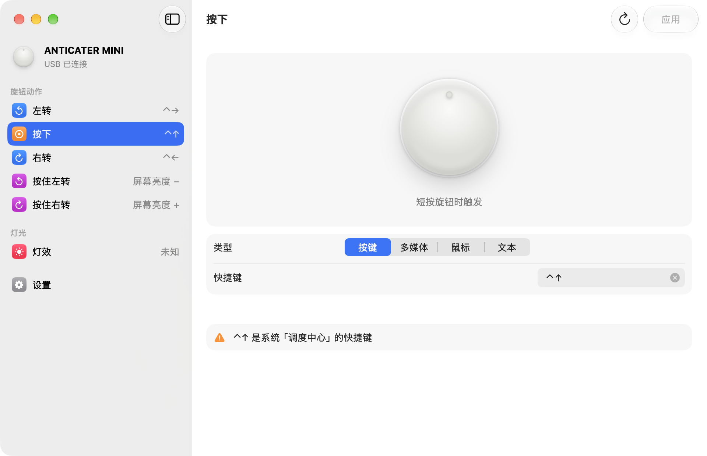

# OpenAnticater

[](https://github.com/panicilllin/OpenAnticater/actions/workflows/ci.yml)
[](LICENSE)


[English](README.md)

**ANTICATER MINI** 桌面音量旋钮的开源 macOS 原生改键 App，可以替代只有 Intel 版的原厂软件，在 Apple Silicon 上原生运行。

<picture>
  <source media="(prefers-color-scheme: dark)" srcset="docs/images/app-zh-dark.png">
  
</picture>

> **非官方项目。** OpenAnticater 是社区项目，与 ANTICATER 产品的厂商没有任何关联，也未获其认可或支持。
> 「ANTICATER」等名称是各自所有者的商标，这里只用来说明兼容的设备。

## 快速上手

1. **安装。** 从 [Releases](https://github.com/panicilllin/OpenAnticater/releases/latest) 下载最新的
   `OpenAnticater-*-arm64.dmg`，打开后把 **OpenAnticater** 拖到「Applications」（应用程序）上。这个版本未经 Apple 公证，第一次打开时：
   在提示框里点「完成」，然后到「系统设置 → 隐私与安全性」点「仍要打开」。（也可以[自己编译](#从源码编译)。）
2. **用 USB 数据线连接旋钮。** App 会自动读取旋钮当前的配置。蓝牙和 2.4G 接收器只传输按键，不能改键。
3. **修改动作。** 在侧栏选一个动作（左转、按下、右转、按住左转 / 右转），选择按键、多媒体、鼠标或文本，直接按键盘录制快捷键。
4. **点「应用」**（⌘S）。App 写入后会读回核对。

## 功能

- 修改旋钮的 5 个动作：左转、按下、右转、按住左转、按住右转
  - 按键 / 组合键（直接按键盘录制）、多媒体键、鼠标、文本（最多 18 个字符）
  - 与 macOS 系统快捷键冲突时给出提示
- 灯效：关闭、白光、绿光、跑马灯、红绿蓝轮换、快速跑马灯
- 插上 USB 线自动读取旋钮当前配置；每次写入后自动读回核对
- 显示蓝牙电量，电量低时可发通知
- 可选的菜单栏菜单、登录时打开
- 外观可选浅色 / 深色 / 跟随系统；支持简体中文和英文，可在 App 内切换，无需重启

## 支持的设备

| 设备 | 状态 |
|---|---|
| ANTICATER MINI 单旋钮款，USB `514C:8850`，固件版本 0 | 已测试 |
| 原厂 App 列出的其他型号（VID `1189` / `514C`，PID `8840 8842 8830–8833 8851`） | 暂不支持 |

欢迎反馈其他型号的情况：请开一个 issue，写明型号、连接方式，并贴上 `swift run knobctl list` 的输出。
这条命令只读取系统的设备列表，不和旋钮通信，也不会输出序列号。在已测试的型号上，`knobctl info` 和 `knobctl read`
同样只读。请不要在其他型号上运行 `write-*`、`led*` 命令。协议资料见 [docs/PROTOCOL.zh-CN.md](docs/PROTOCOL.zh-CN.md)。

## 从源码编译

需要 macOS 26 或更高版本（Apple Silicon）和 Xcode 26 或更高版本。

```bash
./scripts/build-app.sh          # 生成 build/release/OpenAnticater.app
./scripts/make-dmg.sh           # 可选：打包成 dist/OpenAnticater-<版本>-arm64.dmg
open build/release/OpenAnticater.app
```

其他常用命令：

```bash
swift test                      # 协议编解码测试
swift run knobctl list          # 列出 ANTICATER 的 USB / 蓝牙接口（只读，不和设备通信）
swift run knobctl status        # 蓝牙、接收器状态和电量（只读）
swift run knobctl read          # 查看旋钮当前配置（只读）
```

打包脚本使用本地签名（ad-hoc），在自己的 Mac 上运行没有问题。Releases 里的版本由
[GitHub Actions](.github/workflows/release.yml) 在推送 `vX.Y.Z` 标签时用同样的方式打包，并附带构建来源证明
（`gh attestation verify <dmg> -R panicilllin/OpenAnticater`）。它们没有经过 Apple 公证，所以第一次打开时需要手动确认。

## 原理

为实现兼容，分析了原厂 App，并用只读查询和在实物上的谨慎测试确认了改键协议，结果整理在 [docs/PROTOCOL.zh-CN.md](docs/PROTOCOL.zh-CN.md)。

OpenAnticater 用到两个 macOS 私有接口：

- `IOPSCopyPowerSourcesByType`（IOKit）：读取旋钮的蓝牙电量
- `SLSSetGlobalHotKeyOperatingMode`（SkyLight）：录制快捷键时暂停系统快捷键，这样 ⌃← 这类组合键能被录下来，而不是切换桌面

两者都在运行时查找；如果以后的 macOS 去掉了它们，App 仍能运行，只是没有对应功能。因为用了私有接口，本 App 无法上架 Mac App Store。

## 目录

- `Sources/KnobKit`：协议编解码、USB HID 通信、蓝牙 / 接收器检测、电量
- `Sources/OpenAnticater`：SwiftUI 界面
- `Sources/knobctl`：命令行调试工具
- `Resources`：Info.plist、App 图标、本地化文字
- `docs/PROTOCOL.zh-CN.md`：逆向得到的改键协议

## 免责声明

向设备写入设置的风险由你自行承担。协议是逆向得到的，只在上面列出的硬件上测试过。出了问题可以用原厂软件恢复默认值，或在本 App 的「设置 → 恢复出厂设置…」里恢复。

## 许可证

Copyright © 2026 OpenAnticater contributors.

OpenAnticater 是自由软件：你可以依据自由软件基金会发布的 GNU 通用公共许可证（GPL）第 3 版或（由你选择）任何更新的版本，
重新分发和 / 或修改它。详见 [LICENSE](LICENSE)。
